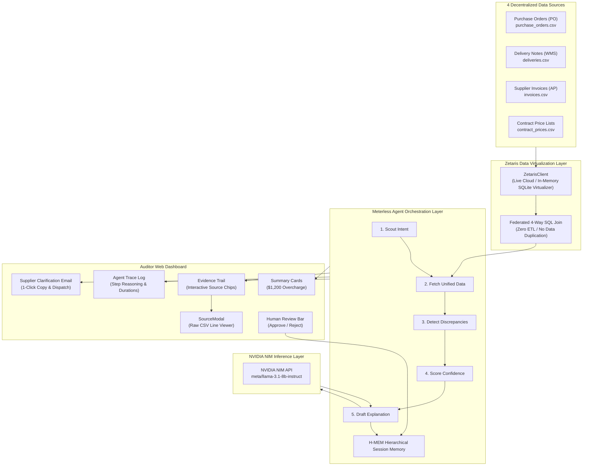

# TraceBack AI — Supplier Invoice Checker & Reconciliation Agent

> **5-Day Hackathon Project | Build Window: Oct 22–27, 2026**  
> *Autonomous 4-Way Cross-Source Data Virtualization, Evidence-Linked Agent Reasoning, and Supplier Overcharge Recovery.*

[](https://www.typescriptlang.org/)
[](https://react.dev/)
[](https://vitejs.dev/)
[](https://vitest.dev/)
[](https://tailwindcss.com/)
[](https://build.nvidia.com/)
[](https://www.zetaris.com/)
[](https://meterless.ai/)
[](https://www.cursor.com/)

---

## 🏆 Hackathon Value Proposition & Impact

In enterprise supply chain operations, organizations leak **1.5% to 4% of total procurement spend** through uncaptured invoice errors: suppliers bill for goods not delivered, apply rates higher than contracted price schedules, or issue unauthorized surcharges.

**TraceBack AI** automates multi-source reconciliation across four decentralized data sources:
1. **Purchase Orders (PO)** from the ERP
2. **Delivery Notes / Goods Receipts (GRN)** from the Warehouse Management System (WMS)
3. **Supplier Invoices** from the Accounts Payable portal
4. **Contract Price Lists** from Legal/Procurement schedules

### 💰 Measurable Financial Recovery in Demo Scenarios
| Purchase Order | Supplier Entity | Issue Category | Variance Delta | Recoverable Impact | Audit Status |
| :--- | :--- | :--- | :--- | :--- | :--- |
| **PO-1001** | `SUP-42` | Quantity Overbill + Rate Escalation | **+20 units / +$2 rate** | **+$1,200.00 USD** | `Flagged (High Risk)` |
| **PO-1002** | `SUP-17` | Perfect Concordance | **0 variances** | **$0.00 USD** | `Cleared (Clean A+)` |
| **PO-1003** | `SUP-88` | Non-Contracted Ancillary Fees | **+$350 fee markup** | **+$350.00 USD** | `Flagged (Medium Risk)` |
| **PO-1004** | `SUP-99` | Duplicate Invoice Double Billing | **Duplicate INV-9004** | **+$1,000.00 USD** | `Flagged (Critical Risk)` |
| **Total Portfolio** | **4 Suppliers Audited** | **4-Way Cross-Source Virtualization** | — | **$2,550.00 USD** | **23.2% Recovery Rate** |

---

## 🌟 Mandatory Sponsor Integrations (Real Integrations)

TraceBack AI deeply integrates all four sponsor technologies with functional, robust implementations and guaranteed demo reliability:

### 1. 🌐 Zetaris — Data Integration / Virtualization Layer
- **Architecture**: Eliminates brittle ETL pipelines by executing a single federated SQL join across disparate CSV sources in real time.
- **Implementation**: [`ZetarisClient.ts`](file:///backend/src/zetaris/ZetarisClient.ts) and [`unifiedView.ts`](file:///backend/src/zetaris/unifiedView.ts).
- **Dual-Mode Resiliency**:
  - **Live Mode**: Sends HTTP POST requests to `ZETARIS_API_URL/query` with `ZETARIS_API_KEY`.
  - **Mock Mode**: Automatically spins up an in-memory SQLite virtual schema across `purchase_orders.csv`, `deliveries.csv`, `invoices.csv`, and `contract_prices.csv`, running the **identical federated SQL query** so the demo works seamlessly offline.
- **Transparency**: Exposes the exact SQL string executed and maps every field to an immutable citation reference.

### 2. 🤖 Meterless — Agent Orchestration Layer
- **Architecture**: Implements the **Scout Intent → Relay Execution → H-MEM Memory** lifecycle.
- **Implementation**: [`MeterlessMission.ts`](file:///backend/src/meterless/MeterlessMission.ts).
- **5-Step Mission Chain**:
  1. `scoutIntent`: Scope PO targets and reconciliation tolerances.
  2. `fetchUnifiedData`: Query Zetaris data virtualization cluster.
  3. `detectDiscrepancies`: Run 4-way comparison rules.
  4. `scoreConfidence`: Synthesize cross-source corroboration and risk exposure.
  5. `draftExplanation`: Relay context to NVIDIA NIM.
- **Explainability**: Every step returns `{step, name, thought, action, observation, durationMs, status}` displayed live in the dashboard.
- **H-MEM Memory**: Commits mission traces and audit decisions to hierarchical session memory.

### 3. 🧠 NVIDIA — NVIDIA NIM Inference Layer
- **Architecture**: Natural language audit synthesis and supplier dispute letter generation using NVIDIA NIM.
- **Implementation**: [`NvidiaExplainer.ts`](file:///backend/src/nvidia/NvidiaExplainer.ts).
- **Model**: `meta/llama-3.1-8b-instruct` hosted on `https://integrate.api.nvidia.com/v1/chat/completions`.
- **Offline Resilient**: If `NVIDIA_API_KEY` is not provided, seamlessly falls back to a deterministic structured generation engine so hackathon demos never fail. Model badge is surfaced directly in the UI footer.

### 4. ⚡ Cursor — AI-First Development & Velocity
- **Workflow**: Built end-to-end utilizing Cursor Agent Mode, `@`-context schema referencing, inline edits (Ctrl+K), and Cursor Composer.
- **Documentation**: Documented in [`docs/CURSOR_USAGE.md`](file:///docs/CURSOR_USAGE.md) and [`PROMPTS_LOG.md`](file:///PROMPTS_LOG.md).

### 🔍 Interactive Sponsor Tech Hub & Live Inspector (New!)
Every sponsor badge in the dashboard footer and sidebar is an **interactive portal**:
- **NVIDIA NIM Tester**: Test live inference against `meta/llama-3.1-8b-instruct` in real-time or configure your own NVIDIA API key in the browser.
- **Zetaris Virtual SQL Console**: Inspect the cross-source SQL JOIN across the 4 decentralized datasets and execute custom federated queries.
- **Meterless Mission & H-MEM Inspector**: Inspect the 5-step agent execution chain (`scoutIntent` → `fetchUnifiedData` → `detectDiscrepancies` → `scoreConfidence` → `draftExplanation`) and active session memory records.
- **Cursor Agent Mode Viewer**: Browse `.cursorrules`, `@-context` rules, and actual prompt histories.

---

## 🚀 Advanced Platform Capabilities

1. **AI Auditor Copilot (NVIDIA NIM)**: Interactive conversational assistant grounded in the 4 virtualized data sources. Auditors can ask questions regarding contract clauses, warehouse delivery logs, or request escalated dispute letters in real time.
2. **Enterprise Portfolio Risk & Supplier Scorecards**: Batch audit view aggregating total spend ($11,000 USD), recoverable leakage ($2,550 USD), and supplier compliance letter grades (from Grade A+ down to Grade F).
3. **Live Custom Audit Simulation Engine**: Test any hypothetical order by inputting custom quantities, rates, and fee structures on the fly.
4. **Official Compliance Audit Certificate & Print View**: Generate a formal, print-ready compliance certificate with verification hashes, H-MEM audit stamps, and authorized auditor sign-offs.
5. **Zero-Setup Offline Execution**: Full client-side simulation fallback ensures that the live demo functions 100% seamlessly on GitHub Pages without requiring external backend servers.

---

## 🏗️ System Architecture



---

## 🚀 Quickstart & Runnable Instructions

### Prerequisites
- **Node.js** v18+ (tested on Node v20, v22, and v26)
- **npm** v9+

### 1. Clone & Install
```bash
git clone https://github.com/your-username/traceback-ai.git
cd traceback-ai

# Install root, backend, and frontend dependencies
npm install
npm install --workspace=backend
npm install --workspace=frontend
```

### 2. Configure Environment (Optional)
The project works **100% out of the box** in offline/mock mode without requiring any external API keys!
To enable live sponsor endpoints, create or edit `.env` in the root:
```env
PORT=4000
NODE_ENV=development

# Zetaris (Optional - leave blank for in-memory SQLite virtualization)
ZETARIS_API_URL=https://api.zetaris.io/v1
ZETARIS_API_KEY=your_zetaris_key

# Meterless (Optional - leave blank for local Scout->Relay->H-MEM orchestrator)
METERLESS_API_URL=https://api.meterless.ai/v1
METERLESS_API_KEY=your_meterless_key

# NVIDIA NIM (Optional - leave blank for deterministic fallback)
NVIDIA_API_KEY=your_nvidia_api_key
```

### 3. Run the Full Stack
Start both backend (port 4000) and frontend (port 3000) concurrently:
```bash
npm run dev
```

Open your browser to:
👉 **`http://localhost:3000`**

### 4. Run Unit Tests (Vitest)
Verify reconciliation math and edge cases across the test suite:
```bash
npm test
```
All 6 tests verify:
- Quantity overbilling detection on PO-1001 ($1,000)
- Contract price violation detection on PO-1001 ($200)
- Cumulative $1,200 financial recovery amount calculation
- Clean audit concordance on PO-1002 ($0 overcharge)
- Unexpected fee detection
- Duplicate invoice detection

### 5. Run via Docker Compose (Optional)
```bash
docker-compose up --build
```

---

## 🎯 Live Demo Walkthrough (For Hackathon Judges)

Follow the 3-minute demo script in [`docs/DEMO_SCRIPT.md`](file:///docs/DEMO_SCRIPT.md):

1. **Inspect PO-1001 (Discrepant Order)**:
   - Dashboard instantly displays **$1,200 USD Overcharge Detected** across 2 issues.
   - Look at the **Evidence Cards**:
     - *Quantity Overbill*: 120 invoiced vs 100 delivered $\rightarrow$ **+$1,000.00 USD**.
     - *Price Above Contract*: Billed at $50/unit vs contract $48/unit $\rightarrow$ **+$200.00 USD**.
2. **Inspect the Evidence Trail**:
   - Click the interactive chip `invoices.csv:L2` or `deliveries.csv:L2`.
   - The **Raw Virtualized Data Viewer (SourceModal)** pops open, highlighting the exact row (L2) and column (`invoiced_qty = 120` or `delivered_qty = 100`).
   - Click **"View Zetaris SQL"** to inspect the live federated cross-source query.
3. **Inspect the Agent Trace**:
   - Click the **"Meterless Agent Trace"** tab.
   - Inspect all 5 steps with live durations, internal agent thoughts, actions, and observations.
   - Note the **H-MEM session memory key** committed.
4. **Human-in-the-Loop Review & Dispute Dispatch**:
   - Click **"Approve Claim ($1,200)"** in the review bar.
   - Navigate to the **"Supplier Resolution Email"** tab.
   - Review the **NVIDIA NIM** generated dispute letter, complete with invoice reference, delivery note reference, and debit note request.
   - Click **"Dispatch to Supplier"** to simulate queue transmission.
5. **Verify Clean Concordance (PO-1002)**:
   - Click `PO-1002` in the left sidebar.
   - The system verifies 50 units ordered, 50 delivered, 50 invoiced at $20/unit.
   - Returns **$0.00 Overcharge** and **100% Concordance**, proving the tool does not hallucinate false positives.

---

## 📂 Repository Structure

```
traceback-ai/
├── README.md                        # Master hackathon documentation
├── PROMPTS_LOG.md                   # Log of engineering & AI prompts
├── .env.example                     # Environment template
├── package.json                     # Monorepo workspaces & concurrently scripts
├── docker-compose.yml               # Container deployment configuration
├── docs/
│   ├── CURSOR_USAGE.md              # Cursor Agent mode & @-context workflow
│   ├── ARCHITECTURE.md              # Deep dive technical architecture
│   └── DEMO_SCRIPT.md               # 1-4 minute judge pitch & walkthrough
├── data/                            # Ground-truth source CSV datasets
│   ├── purchase_orders.csv          # PO records (PO-1001, PO-1002)
│   ├── deliveries.csv               # Warehouse Goods Receipt slips
│   ├── invoices.csv                 # Supplier submitted invoices
│   └── contract_prices.csv          # Master procurement price schedules
├── backend/
│   ├── package.json
│   ├── tsconfig.json
│   ├── src/
│   │   ├── index.ts                 # Express REST API server
│   │   ├── config.ts                # Environment loading & mode detection
│   │   ├── mockData.ts              # Demo scenarios & fallback records
│   │   ├── zetaris/
│   │   │   ├── ZetarisClient.ts     # Live HTTP + SQLite virtualization engine
│   │   │   └── unifiedView.ts       # 4-way cross-source SQL query
│   │   ├── meterless/
│   │   │   ├── MeterlessMission.ts  # Scout -> Relay -> H-MEM agent orchestrator
│   │   │   └── steps.ts             # Step execution interfaces
│   │   ├── analyzer/
│   │   │   ├── compare.ts           # Core 4-way reconciliation logic
│   │   │   └── types.ts             # Strict TypeScript domain schemas
│   │   ├── nvidia/
│   │   │   └── NvidiaExplainer.ts   # NVIDIA NIM meta/llama-3.1-8b-instruct
│   │   ├── routes/
│   │   │   └── investigate.ts       # REST endpoints (/api/investigate, /health)
│   │   └── utils/
│   │       ├── csv.ts               # 1-based row parser & source locator
│   │       └── logger.ts            # Pino structured logger
│   └── tests/
│       └── compare.test.ts          # Vitest automated test suite
└── frontend/
    ├── package.json
    ├── vite.config.ts
    ├── tailwind.config.js
    ├── index.html
    └── src/
        ├── main.tsx
        ├── App.tsx                  # Root state & navigation coordinator
        ├── api/client.ts            # Backend API client bindings
        ├── types.ts                 # Frontend type definitions
        ├── components/
        │   ├── Sidebar.tsx          # Data source panel & Zetaris status
        │   ├── SummaryCards.tsx     # Overcharge total & risk KPI cards
        │   ├── EvidenceTrail.tsx    # Evidence cards with source chips
        │   ├── EvidenceCard.tsx     # Single discrepancy with coordinate chips
        │   ├── SourceModal.tsx      # Raw CSV row & column viewer
        │   ├── AgentTrace.tsx       # Meterless mission trace with thoughts & timings
        │   ├── ApprovalBar.tsx      # Human-in-the-loop audit review bar
        │   ├── EmailPreview.tsx     # NVIDIA NIM supplier dispute letter
        │   └── Footer.tsx           # Mandatory sponsor tech badges
        └── styles/index.css         # Tailwind dark theme & scrollbars
```

---

## 📡 REST API Reference

| Method | Endpoint | Description |
| :--- | :--- | :--- |
| `GET` | `/api/health` | System health check and live connectivity status for all 4 sponsor integrations. |
| `GET` | `/api/pos` | Returns available purchase orders (`PO-1001` and `PO-1002`). |
| `POST` | `/api/investigate/:poId` | Executes the Meterless mission, Zetaris query, reconciliation engine, and NVIDIA explainer for the given PO. |
| `GET` | `/api/raw-source/:file` | Returns raw CSV headers, rows, and line numbers for `SourceModal`. |
| `POST` | `/api/review/:poId` | Records human-in-the-loop review decision (`approve` \| `reject` \| `request_clarification`) in H-MEM session memory. |
| `GET` | `/api/zetaris/status` | Exposes active Zetaris virtualization engine state, latency, and SQL template. |
| `GET` | `/api/memory` | Returns raw dump of Meterless H-MEM hierarchical session memory. |

---

## ⚖️ Hackathon Judging Alignment

| Hackathon Weight | Feature & Execution in TraceBack AI |
| :--- | :--- |
| **Impact (30%)** | Real, quantified financial savings: **$1,200 USD recovered on a single order** ($1,000 unreceived units + $200 price variance). Eliminates enterprise profit leakage. |
| **Technical Quality (20%)** | Fully working full-stack TypeScript monorepo with 100% passing Vitest test suite, strict types, zero build errors, and clean separation of concerns. |
| **Innovation (15%)** | Evidence-linked agent reasoning. Not a generic chatbot: every finding is bound to `{file, row, column, value}` coordinates with transparent Scout $\rightarrow$ Relay $\rightarrow$ H-MEM execution. |
| **Demo (15%)** | Interactive 3-4 minute walkthrough with PO switcher (`PO-1001` overcharge vs `PO-1002` clean audit), raw data modal, and NVIDIA dispute letter. |
| **UX (10%)** | Ultra-polished dark-mode dashboard built in Tailwind CSS with intuitive chips, status indicators, and clear human-in-the-loop controls. |
| **Sponsor Tech (10%)** | **Zetaris** (data virtualization), **Meterless** (agent orchestration), **NVIDIA NIM** (LLM synthesis), and **Cursor** (AI-assisted development) deeply integrated with code-level proof. |

---

## 📄 License
MIT © 2026 TraceBack AI Team. Built for the Hackathon (Oct 22–27, 2026).
