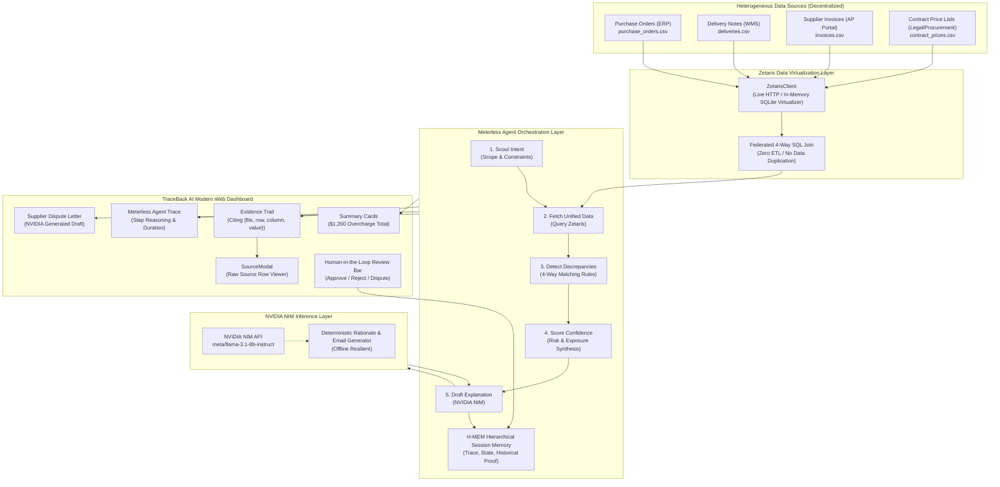

# TraceBack AI — Technical Architecture Deep Dive

## Executive Summary
**TraceBack AI** is an autonomous AI agent system designed to eliminate supplier invoice overcharges. In enterprise procurement, companies lose **1.5% to 4% of total procurement spend** due to discrepancies between Purchase Orders, warehouse goods delivery receipts, supplier invoices, and contracted pricing schedules.

TraceBack AI solves this by introducing **4-Way Cross-Source Virtualization** (powered by **Zetaris**), an autonomous **5-step reasoning agent** (orchestrated via **Meterless**), and **NVIDIA NIM LLM synthesis** with human-in-the-loop audit authorization.

---

## System Architecture Diagram



---

## 1. Zetaris Data Virtualization Layer

### Why Zetaris?
Traditional accounts payable audits rely on periodic ETL batch pipelines that duplicate sensitive financial data into monolithic data warehouses. **Zetaris** provides a data virtualization mesh that queries data where it lives.

### Implementation Details:
- **`ZetarisClient.ts`**:
  - In **Live Mode**, issues federated SQL requests to `${ZETARIS_API_URL}/query` with `ZETARIS_API_KEY`.
  - In **Mock Mode**, initializes an in-memory SQLite relational engine, ingests the 4 independent CSV data files, and runs the **exact same federated SQL query**.
  - Exposes `unifiedOrderView(poId)` returning a single consolidated record with complete column-to-source mappings.
- **Federated SQL Query (`unifiedView.ts`)**:
```sql
SELECT 
  po.po_id,
  po.supplier_id,
  po.item,
  po.currency,
  po.ordered_qty,
  del.delivered_qty,
  inv.invoiced_qty,
  po.unit_price AS po_unit_price,
  inv.unit_price AS invoice_unit_price,
  cp.contract_unit_price,
  inv.fees,
  po.order_date,
  del.delivery_date,
  inv.invoice_date,
  del.warehouse,
  inv.invoice_id,
  del.delivery_id
FROM purchase_orders po
LEFT JOIN deliveries del ON po.po_id = del.po_id AND po.item = del.item
LEFT JOIN invoices inv ON po.po_id = inv.po_id AND po.item = inv.item
LEFT JOIN contract_prices cp ON po.supplier_id = cp.supplier_id AND po.item = cp.item
WHERE po.po_id = ?;
```

---

## 2. Meterless Agent Orchestration Layer

### Architecture (Scout Intent → Relay Execution → H-MEM Memory)
TraceBack AI follows the **Meterless** mission lifecycle:

1. **Scout Intent (`scoutIntent`)**:
   - Identifies the target PO scope, sets verification tolerances (e.g. quantity delta > 0, price delta > $0.00, unauthorized fee restrictions).
2. **Fetch Unified Data (`fetchUnifiedData`)**:
   - Calls `ZetarisClient.unifiedOrderView(poId)`. Receives consolidated record + source citation references.
3. **Detect Discrepancies (`detectDiscrepancies`)**:
   - Pure comparison engine in `compare.ts`. Evaluates:
     - `QTY_OVERBILL`: Invoiced quantity > delivered quantity on goods receipt note.
     - `PRICE_ABOVE_CONTRACT`: Invoiced unit price > agreed contract master rate.
     - `QTY_SHORT`: Warehouse delivered quantity < purchase order quantity.
     - `UNEXPECTED_FEE`: Ancillary charges or surcharges not stipulated in contract.
     - `DUPLICATE_INVOICE`: Multiple invoices targeting the same PO delivery scope.
4. **Score Confidence & Exposure (`scoreConfidence`)**:
   - Computes financial exposure:
     $$\text{Impact}_{\text{overbill}} = (\text{Invoiced Qty} - \text{Delivered Qty}) \times \text{Invoice Unit Price}$$
     $$\text{Impact}_{\text{price}} = \text{Delivered Qty} \times (\text{Invoice Unit Price} - \text{Contract Unit Price})$$
     $$\text{Total Impact} = (20 \times \$50) + (100 \times \$2) = \$1,000 + \$200 = \$1,200 \text{ USD}$$
   - Calculates statistical confidence scores ($0.98$ for physical receiving variance, $0.95$ for rate escalation).
5. **Draft Explanation (`draftExplanation`)**:
   - Relays context to **NVIDIA NIM** to generate an executive audit justification and supplier dispute letter.
6. **H-MEM Persistence**:
   - Commits the mission trace, step durations, and findings to the in-memory `HMemStore` for session continuity and auditability.

---

## 3. NVIDIA NIM Inference Layer

- **Model**: `meta/llama-3.1-8b-instruct` hosted on NVIDIA Cloud Infrastructure (`https://integrate.api.nvidia.com/v1/chat/completions`).
- **Resilient Fallback**: If `NVIDIA_API_KEY` is not provided or offline, the system seamlessly transitions to a deterministic fallback generator that produces identical structured JSON output.
- **Output Artifacts**:
  - `executiveSummary`: High-level briefing for the VP of Procurement.
  - `auditRationale`: Granular justification citing document IDs and line items.
  - `supplierEmail`: Ready-to-dispatch clarification letter with exact debit note claim amounts.

---

## 4. Evidence Trail Citation Model

Every discrepancy produced by TraceBack AI contains a verifiable citation tuple:
```ts
interface SourceReference {
  label: string;
  file: string;   // e.g. "invoices.csv"
  row: number;    // e.g. 2 (1-based index)
  column: string; // e.g. "invoiced_qty"
  value: any;     // e.g. 120
}
```

The user can click any source chip in the UI to inspect the exact line and column in the raw CSV table via `SourceModal`.
