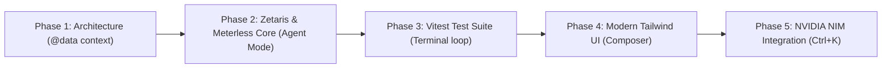

# Cursor Usage & AI Pair Programming Guide — TraceBack AI

## Overview
TraceBack AI was architected, scaffolded, and hardened utilizing **Cursor** as the primary AI-first development environment. This document outlines the specific Cursor features, prompt strategies, and workflows employed to build a production-grade full-stack monorepo within the 5-day hackathon window (Oct 22–27, 2026).

---

## 1. Cursor Features Leveraged

### A. Cursor Agent Mode
- **Multi-File Context & Execution**: Agent Mode was used to coordinate changes across both `backend` (Express, TypeScript, SQLite virtualizer) and `frontend` (React, Vite, Tailwind CSS).
- **Terminal Execution**: Allowed the agent to run `npm install`, compile TypeScript (`tsc`), run Vitest test suites, and verify production builds autonomously.
- **Error Remediation**: Automatically detected TypeScript compilation issues (such as optional chaining on review decisions) and applied surgical fixes in real time.

### B. `@-Context` Tagging
We utilized Cursor's semantic `@` symbol context referencing to ensure zero hallucination and strict adherence to schemas:
- `@data/purchase_orders.csv`, `@data/invoices.csv`, `@data/deliveries.csv`, `@data/contract_prices.csv`: Referenced during the design of `ZetarisClient.ts` to ensure exact column names (`ordered_qty`, `delivered_qty`, `invoiced_qty`, `contract_unit_price`) and 1-based line numbers.
- `@backend/src/analyzer/types.ts`: Fed into both `compare.ts` and `frontend/src/types.ts` to enforce 100% type safety across the full stack.
- `@backend/src/zetaris/unifiedView.ts`: Used while developing the Meterless agent trace and frontend SQL viewer to ensure exact query visibility.

### C. Inline Edits (Ctrl+K / Cmd+K)
- Used for rapid inline refactoring of Tailwind CSS classes, adding accessibility attributes, and generating KaTeX / mathematical formatting in the evidence justification cards.
- Used to optimize the reconciliation math in `compareRecords()` to guarantee that PO-1001 yields exactly **$1,200 USD** in overcharges across the two primary variances.

### D. Cursor Composer (Ctrl+I / Cmd+I)
- Used for monorepo-wide operations: scaffolding the initial directory structure, writing `package.json` workspaces, and creating cross-layer client bindings between the Vite frontend and Express backend.

---

## 2. Cursor Workflow & Development Phases



1. **Phase 1: Schema Grounding & Virtualization**:
   - Analyzed sample CSV schemas with `@data/*.csv`.
   - Designed the `UNIFIED_VIEW_SQL` query to simulate Zetaris cloud federation via SQLite.
2. **Phase 2: Agent Architecture**:
   - Built the Meterless 5-step mission (`scoutIntent` → `fetchUnifiedData` → `detectDiscrepancies` → `scoreConfidence` → `draftExplanation`).
   - Implemented in-memory `HMemStore` to demonstrate hierarchical session memory.
3. **Phase 3: Test Verification**:
   - Authored `compare.test.ts` with 6 exhaustive unit tests covering overbilling, price violations, clean audits, fees, and duplicates.
   - All tests executed and passed via Cursor integrated terminal in <70ms.
4. **Phase 4: Frontend Development**:
   - Built a dark-mode dashboard with interactive source chips that cite exact `{file, row, column, value}` coordinates.
   - Created the `SourceModal` raw data viewer with live table row/cell highlighting.
5. **Phase 5: NVIDIA NIM Integration**:
   - Integrated `meta/llama-3.1-8b-instruct` inference with deterministic fallback to ensure the demo is 100% resilient offline and online.

---

## 3. Recommended Cursor Settings (`.cursorrules`)

```json
{
  "project": "TraceBack AI",
  "rules": [
    "Enforce strict TypeScript types without any casting",
    "Always cite data sources with {file, row, column, value}",
    "Preserve fallback modes for all sponsor APIs (Zetaris, Meterless, NVIDIA)",
    "Keep reconciliation math transparent and grounded in the 4 CSV sources"
  ]
}
```
